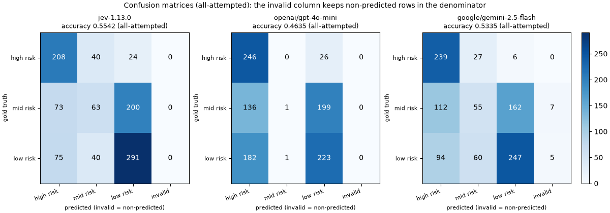
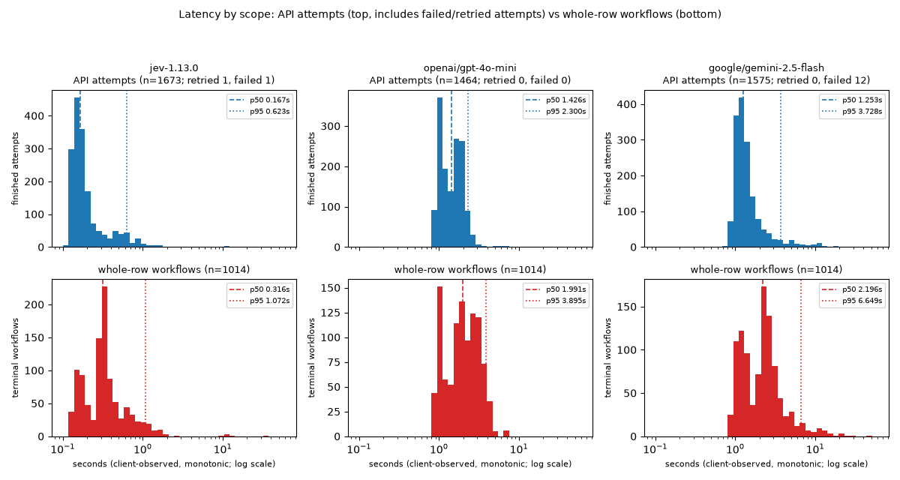
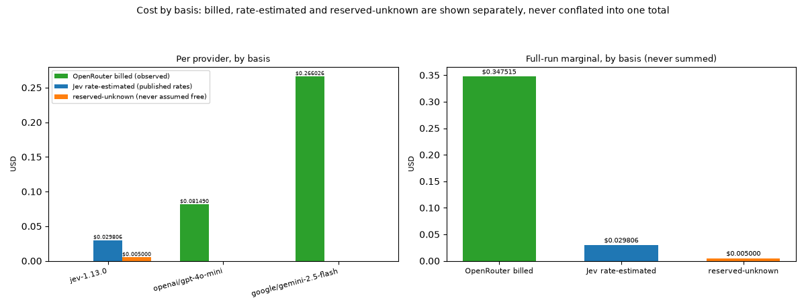

# jev-benchmark

Retrospective benchmark comparing **Jev** (`jev-1.13.0`) with two OpenRouter
LLMs (`openai/gpt-4o-mini`, `google/gemini-2.5-flash`) on their ability to
reproduce the existing public **UCI Maternal Health Risk** labels (dataset 863,
CC BY 4.0) from six routine measurements.

> **Not a clinical tool.** This project replicates existing dataset labels. It
> makes no diagnosis, triage, treatment, patient-safety, clinical-validity, or
> calibration claim. See [Limitations](#limitations).

## What was measured

Each of the official CSV's **1,014 rows** was sent to all three systems in a
single frozen order (**3,042 row-provider pairs**), using a shared two-stage
task: stage 1 asks *high risk vs other*; only the provider's **own** `other`
answer triggers its stage 2 (*mid vs low*). The gold `RiskLevel` label never
enters any request. The experiment was fully completed in one real sequential
run (`run-20261006T142452Z`; every planned pair is accounted for). Every number
in this README derives from that one run's committed artifacts under
[`published/`](published/MANIFEST.json) and recomputes offline with
`jev-benchmark report --from published`.

Run identity (verifiable offline from the artifacts):

| Field | Value |
|---|---|
| Run id | `run-20261006T142452Z` (status `complete`) |
| Pairs completed | 3,042 / 3,042 (1,014 rows x 3 providers) |
| Frozen task config hash | `6c7bab9c0fee0d1f35bc47e32caafafeb238890c17ee74e25c107b3f426f3440` |
| Dataset ordered-record hash | `ea285a63e5a4c16a5cfa8622db164edd932dc97046dff455b70ba784b43dcffe` |
| Returned model identities | all 3,042 cases returned exactly the requested pinned model id |

## Dataset, attribution, and known anomalies

Source: [Maternal Health Risk](https://archive.ics.uci.edu/dataset/863/maternal+health+risk),
UCI Machine Learning Repository (dataset 863). Citation: Ahmed, Marzia. (2020).
*Maternal Health Risk* [Dataset]. UCI Machine Learning Repository.
https://doi.org/10.24432/C5DP5D - licensed **CC BY 4.0**. The raw CSV is
committed at `data/raw/maternal_health_risk.csv` so every offline step works
without network access.

Known anomalies are disclosed, not hidden:

- The served CSV has **1,014 rows**; UCI's metadata page reports **1,013
  instances**. All 1,014 rows are retained in source order; the discrepancy is
  documented, never silently resolved.
- There are **452 distinct complete rows** and **416 distinct feature
  vectors**; **35 feature-vector groups carry conflicting labels** (215 rows).
  Duplicates stay in the primary population; a separate
  [sensitivity analysis](#duplicate-row-sensitivity) re-weights them.
- Gold class distribution: **high risk 272 / mid risk 336 / low risk 406** (no
  missing values).
- Only the six measurements (`Age`, `SystolicBP`, `DiastolicBP`, `BS`,
  `BodyTemp`, `HeartRate`) are ever sent to a provider; `RiskLevel` is local
  truth only.

## Results (from the completed run only)

### Coverage

| Provider | Attempted | Predicted | Invalid/abstained | Failed | Unattempted |
|---|---|---|---|---|---|
| `jev-1.13.0` | 1,014 | 1,014 | 0 | 0 | 0 |
| `openai/gpt-4o-mini` | 1,014 | 1,014 | 0 | 0 | 0 |
| `google/gemini-2.5-flash` | 1,014 | 1,002 | 12 | 0 | 0 |

Gemini's 12 non-predicted rows were all invalid-JSON parse failures (8 at
stage 1, 4 at stage 2); they remain in the population and are scored as
incorrect below. Jev had one timed-out attempt (row 649) that succeeded on
retry, so its case is predicted; the timed-out attempt's cost exposure stays
conservatively reserved as unknown.

### Primary metrics - all attempted rows (conservative)

Invalid/abstained/failed outcomes count as **incorrect**: a false negative for
their true class, never a false positive for another class. Accuracy =
correct/attempted; macro-F1 averages the three published-class F1 values;
balanced accuracy averages the three class recalls. No zero-division occurred
in this run (convention: an undefined precision/recall would be 0 and stated).

| Provider | Accuracy | Macro-F1 | Balanced accuracy | High-risk recall |
|---|---|---|---|---|
| `jev-1.13.0` | **0.5542** (562/1014) | **0.5191** | **0.5563** | 0.7647 |
| `google/gemini-2.5-flash` | 0.5335 (541/1014) | 0.4995 | 0.5502 | 0.8787 |
| `openai/gpt-4o-mini` | 0.4635 (470/1014) | 0.3722 | 0.4855 | **0.9044** |

### Secondary metrics - successful outputs only (narrower coverage)

| Provider | Coverage | Accuracy | Macro-F1 | High-risk recall |
|---|---|---|---|---|
| `jev-1.13.0` | 1014/1014 (100.0%) | 0.5542 | 0.5191 | 0.7647 |
| `openai/gpt-4o-mini` | 1014/1014 (100.0%) | 0.4635 | 0.3722 | 0.9044 |
| `google/gemini-2.5-flash` | 1002/1014 (98.8%) | 0.5399 | 0.5019 | 0.8787 |

### Per-class precision / recall / F1 (all attempted)

| Provider | Class | Precision | Recall | F1 | Predicted | Support |
|---|---|---|---|---|---|---|
| `jev-1.13.0` | high risk | 0.5843 | 0.7647 | 0.6624 | 356 | 272 |
| `jev-1.13.0` | mid risk | 0.4406 | 0.1875 | 0.2630 | 143 | 336 |
| `jev-1.13.0` | low risk | 0.5650 | 0.7167 | 0.6319 | 515 | 406 |
| `openai/gpt-4o-mini` | high risk | 0.4362 | 0.9044 | 0.5885 | 564 | 272 |
| `openai/gpt-4o-mini` | mid risk | 0.5000 | 0.0030 | 0.0059 | 2 | 336 |
| `openai/gpt-4o-mini` | low risk | 0.4978 | 0.5493 | 0.5222 | 448 | 406 |
| `google/gemini-2.5-flash` | high risk | 0.5371 | 0.8787 | 0.6667 | 445 | 272 |
| `google/gemini-2.5-flash` | mid risk | 0.3873 | 0.1637 | 0.2301 | 142 | 336 |
| `google/gemini-2.5-flash` | low risk | 0.5952 | 0.6084 | 0.6017 | 415 | 406 |

### Confusion matrices (rows = truth; columns = predicted + invalid)

`jev-1.13.0`

| truth \ predicted | high risk | mid risk | low risk | invalid |
|---|---|---|---|---|
| high risk | 208 | 40 | 24 | 0 |
| mid risk | 73 | 63 | 200 | 0 |
| low risk | 75 | 40 | 291 | 0 |

`openai/gpt-4o-mini`

| truth \ predicted | high risk | mid risk | low risk | invalid |
|---|---|---|---|---|
| high risk | 246 | 0 | 26 | 0 |
| mid risk | 136 | 1 | 199 | 0 |
| low risk | 182 | 1 | 223 | 0 |

`google/gemini-2.5-flash`

| truth \ predicted | high risk | mid risk | low risk | invalid |
|---|---|---|---|---|
| high risk | 239 | 27 | 6 | 0 |
| mid risk | 112 | 55 | 162 | 7 |
| low risk | 94 | 60 | 247 | 5 |



*All-attempted confusion heatmaps: 3 truth rows x 4 prediction columns,
including the explicit `invalid` column. Every cell value matches the tables
above (regenerate offline with `jev-benchmark figures --from published
--out docs/figures`).*

### Latency (client-observed, monotonic; two scopes, never mixed)

| Provider | API attempt p50 | API attempt p95 | API n | Workflow p50 | Workflow p95 | Workflow n | Retried | Failed attempts |
|---|---|---|---|---|---|---|---|---|
| `jev-1.13.0` | 0.167 s | 0.623 s | 1,673 | 0.316 s | 1.072 s | 1,014 | 1 | 1 |
| `openai/gpt-4o-mini` | 1.426 s | 2.300 s | 1,464 | 1.991 s | 3.895 s | 1,014 | 0 | 0 |
| `google/gemini-2.5-flash` | 1.253 s | 3.728 s | 1,575 | 2.196 s | 6.649 s | 1,014 | 0 | 12 |

- **API attempt** covers each finished call, including completed failed/retried
  attempts; **workflow** covers the whole row-provider two-stage workflow.
- Jev's single failed attempt was the row-649 stage-1 timeout (31.5 s wall;
  10 s client timeout), retried successfully. Gemini's 12 failed attempts are
  the invalid-JSON responses (p50 1.355 s, max 1.891 s). Every recorded
  attempt has both a start and an end time.
- Stage counts: Jev 356 one-stage / 658 two-stage cases; GPT-4o-mini 564/450;
  Gemini 453/561.
- Total active dispatch time: **5,396.4 s** (the cumulative client-observed,
  monotonic-clock time spent dispatching all 3,042 sequential row-provider
  pairs; idle time is not counted). Dispatch was strictly sequential, from
  one host; these figures are not a general performance benchmark.



*Top row: the **API-attempt** scope (each finished call, including the completed
failed and retried attempts). Bottom row: the **whole-row-workflow** scope (one
or two calls per row-provider pair). p50/p95 and sample counts are marked in
each panel; the two scopes are drawn on separate rows and never mixed.*

### Cost (bases kept separate, never conflated)

| Provider | OpenRouter billed | Jev rate-estimated | Unknown reserved | Input tokens | Output tokens |
|---|---|---|---|---|---|
| `jev-1.13.0` | - (Jev has no billed-dollar field) | $0.029806 | $0.005000 | 656,162 | 53,504 |
| `openai/gpt-4o-mini` | $0.081490 | - | - | 391,008 | 38,064 |
| `google/gemini-2.5-flash` | $0.266026 | - | - | 373,385 | 61,604 |

- **Full-run marginal spend: $0.382321** = $0.347515 OpenRouter billed +
  $0.029806 Jev published-rate estimate ($0.042 per million tokens; Jev usage
  reports tokens but no billed dollars) + $0.005000 retained as unknown for
  the one attempt whose usage never arrived (never assumed free).
- **Shared cumulative guard: $0.490581 of the $20.00 cap** (snapshot committed
  at `published/shared_budget.json`): $0.10 planning seed + $0.349351 billed +
  $0.029914 Jev estimated + $0.011316 unknown. The $20 figure is a
  conservative local software guard, **not** a vendor-enforced Jev account cap.
- One pre-repair planning preflight (~$0.000479 total: $0.0004434 OpenRouter
  billed + 781/64 Jev tokens ~ $0.0000355) predates the durable ledger format;
  it is disclosed here and in `published/preflight-20261005T182244Z.json`
  once, neither lost nor double-counted.



*OpenRouter observed billed cost, Jev published-rate estimate and
reserved-unknown exposure shown as three separate series; the bars are never
stacked or summed into a single "total cost".*

### Paired uncertainty

All three systems scored the same frozen rows, so comparisons are paired.

**95% bootstrap intervals** (nonparametric row bootstrap, 10,000 resamples,
fixed seed 20261006; denominators are each provider's 1,014 attempted rows):

| Provider | Accuracy | Macro-F1 | High-risk recall |
|---|---|---|---|
| `jev-1.13.0` | [0.5237, 0.5858] | [0.4903, 0.5485] | [0.7128, 0.8145] |
| `openai/gpt-4o-mini` | [0.4329, 0.4951] | [0.3505, 0.3936] | [0.8677, 0.9377] |
| `google/gemini-2.5-flash` | [0.5039, 0.5641] | [0.4712, 0.5282] | [0.8379, 0.9155] |

**Exact McNemar tests** on all-attempted correctness (two-sided binomial on
discordant pairs; **no multiple-comparison correction** - descriptive only):

| Pair | A-only correct | B-only correct | Exact p |
|---|---|---|---|
| Jev vs GPT-4o-mini | 196 | 104 | 1.2e-07 |
| Jev vs Gemini Flash | 140 | 119 | 0.214 |
| GPT-4o-mini vs Gemini Flash | 63 | 134 | 4.7e-07 |

The Jev-Gemini accuracy difference is **not** statistically significant here;
no superiority claim between them is made.

### Duplicate-row sensitivity

The primary population (1,014 rows, duplicates retained) is unchanged; these
views re-weight the same predictions (first source row per group):

| View | Jev acc / macro-F1 / high-rec | GPT-4o-mini | Gemini Flash |
|---|---|---|---|
| Primary (1,014 rows) | 0.5542 / 0.5191 / 0.7647 | 0.4635 / 0.3722 / 0.9044 | 0.5335 / 0.4995 / 0.8787 |
| 452 distinct complete rows | 0.5907 / 0.5212 / 0.6696 | 0.4912 / 0.3694 / 0.8393 | 0.5708 / 0.5105 / 0.8393 |
| 381 non-conflicting feature vectors | 0.6220 / 0.5460 / 0.6832 | 0.5118 / 0.3782 / 0.8416 | 0.5984 / 0.5326 / 0.8416 |

The 381-row view excludes the 35 conflicting-label groups (215 rows) because
their gold label is ambiguous. Rankings are unchanged under both views.

### Two-stage gating (re-verified from saved data)

From the committed stage journal alone: 4,699 journaled successful stages; all
1,665 stage-2 dispatches followed the **same provider's own** stage-1 `other`
answer; all 1,365 stage-1 `high` answers ended without a stage 2; the journal
reconciles exactly with the successful attempts in the case records. The gold
label or another provider's answer never selected a branch.

### Exploratory: stage-1 self-reported probabilities (not a calibration claim)

Providers' self-reported `P(high)` at stage 1, against the gold high-vs-other
split: Jev Brier 0.1317 (n=1014; mean P(high) 0.6778 when gold high vs 0.2385
otherwise), GPT-4o-mini 0.2600 (0.7833 / 0.4497), Gemini Flash 0.2167 (n=1006;
0.8414 / 0.3023). These are **exploratory only**: self-reported probabilities
are not validated calibrated estimates, are not guaranteed to agree with the
provider's own recorded choice (Jev can choose `high` while reporting
`P(high) = 0.21`), and Jev's and OpenRouter's scales are not known to be
comparable. No calibration claim is made.

## Observations (evidence-based, from this one run)

1. **Jev scored best on the primary aggregate metrics** in this run (accuracy
   0.5542, macro-F1 0.5191), and the paired test distinguishes it from
   GPT-4o-mini (p ~ 1e-7) but **not** from Gemini Flash (p = 0.214).
2. **All three systems are weak on the mid-risk class** (best mid recall 0.1875,
   Jev). GPT-4o-mini almost never answered `mid` at stage 2 (2 of 1,014 rows),
   which collapses its macro-F1 despite the highest high-risk recall (0.9044 at
   precision 0.4362 - it predicted `high risk` for 564 of 1,014 rows).
3. **Gemini Flash lost 1.2% coverage to invalid JSON** (12 rows). Under the
   conservative all-attempted view these count as incorrect; its success-only
   accuracy is 0.5399. A provider's output reliability affects the primary
   score, which is intentional.
4. **Jev was much faster on this host and day** (API p50 0.167 s vs ~1.3-1.4 s;
   whole-workflow p50 0.316 s vs ~2.0-2.2 s). This is a single sequential
   session's client-observed latency, not a general performance claim.
5. **Deduplication does not change the ranking** (table above), but accuracy
   rises for every provider once repeated rows are removed, so the primary
   1,014-row numbers are partly shaped by the dataset's heavy duplication
   (452 distinct rows) and its 35 conflicting-label groups.
6. **The full comparison cost under half a dollar of marginal spend**
   ($0.382321), far below the $20 conservative software guard.

## Limitations

- **No clinical validity.** This is retrospective replication of existing
  dataset labels. Nothing here measures real maternal outcomes, triage
  quality, or patient safety, and the results must not be used for care.
- **Contamination and label provenance.** The dataset is public and very likely
  present in LLM pretraining corpora, so apparent accuracy may partly reflect
  memorization rather than reasoning. The labels themselves are not
  independently adjudicated and contain internal conflicts (35 duplicate
  feature groups with disagreeing labels).
- **Dataset anomalies.** 1,014 served rows vs 1,013 in UCI metadata; 452
  distinct complete rows; no row was dropped or deduplicated in the primary
  population.
- **Self-reported probabilities are not calibrated.** Jev's confidence and
  probability fields and the OpenRouter models' reported probabilities are
  provider-reported numbers with no validated calibration; the exploratory
  Brier section above is descriptive only, and cross-provider probability
  comparisons are not meaningful.
- **Timing and cost are session-specific.** One host, one window, sequential
  dispatch, live hosted models; routing, load, network, and prices change over
  time. Jev spend is a published-token-rate **estimate** (Jev exposes no
  billed-dollar field), and unknown-usage attempts are conservatively reserved,
  not assumed free.
- **A live rerun will differ.** Hosted models, provider routing, network
  conditions, and prices can all change; predictions, latency, and cost of a
  new run are expected to differ from the published run.

## Repository layout

| Path | Contents |
|---|---|
| `src/jev_benchmark/` | package: dataset prep, frozen spec, providers, runner, budget, metrics, report, figures |
| `published/` | sanitized, non-secret artifacts of the completed run (`MANIFEST.json` lists files + SHA-256 + byte sizes, verified by the `report` command) |
| `docs/figures/` | committed result PNGs (confusion, latency, cost), regenerated byte-identically offline by `jev-benchmark figures` |
| `notebooks/benchmark.ipynb` | executed offline results notebook (reads `published/` only; no network) |
| `data/raw/maternal_health_risk.csv` | official UCI CSV, committed verbatim (CC BY 4.0) |
| `data/provenance.json`, `data/audit.json` | source provenance and duplicate audit |
| `tests/` | deterministic test suite (no paid calls; live paths are exercised by the CLI commands) |
| `runs/` (git-ignored) | local live-run artifacts: preflight records, pilots, measured runs, shared budget |

## Setup

Requires **Python 3.12**, with a Python 3.12 interpreter available on your
`PATH` (the commands below invoke it as `python3.12`; substitute your own
interpreter's path if that name is not present). From the repository root:

```sh
python3.12 -m venv .venv
.venv/bin/python -m pip install -e '.[dev]'
```

For **live** commands only, create a git-ignored `.env` in the repository root
with the two credential names (never commit it; `.env.example` lists the
names):

```
TYPESAFE_API_KEY=
OPENROUTER_API_KEY=
```

## Offline reproduction of the published results (no keys, no network)

A fresh clone reproduces every README number from the committed artifacts:

```sh
# 1. All published metrics, confusion, latency, cost, uncertainty, sensitivity
.venv/bin/jev-benchmark report --from published

# 2. Regenerate the committed docs/figures/ PNGs (byte-identical for an
#    unchanged artifact set; never writes into published/)
.venv/bin/jev-benchmark figures --from published --out docs/figures

# 3. The executed-results notebook (writes a copy to /tmp; the committed file
#    already contains its outputs)
.venv/bin/jupyter nbconvert --to notebook --execute notebooks/benchmark.ipynb \
    --output /tmp/benchmark-executed.ipynb

# 4. Review the frozen pre-run definition and dataset audit (offline; reads
#    the committed data/ artifacts)
.venv/bin/jev-benchmark inspect

# 5. Tests and lint
.venv/bin/pytest -q
.venv/bin/ruff check .
```

The report command verifies that the published run's frozen dataset and task
identities match the committed data and current code, checks every file listed
in `published/MANIFEST.json` against its recorded SHA-256 and byte size,
recomputes all metrics from `published/cases.jsonl`, and accepts only the
completed official-population run (mode `run`, 1,014 rows x 3 pinned providers
= 3,042 pairs) - a partial, mismatched, pilot, or `--rows`-reduced run is
refused rather than reported as the completed benchmark. No credential is read
at any point. The `figures` command derives the three PNGs from the same
report numbers, so a figure cannot disagree with a published table, and it
refuses to write inside the pinned artifact directory.

## Running a new live benchmark (your keys, your credits)

Live commands are paid and sequential, gated by a conservative shared **$20
estimated-exposure** software guard that spans preflight, pilots, the measured
run, and retries. Run them from the repository root (paths and the shared
ledger are working-directory relative):

```sh
# 1. Fetch/validate the official dataset and record provenance + audit
#    (skippable offline: the committed data/ artifacts already exist)
.venv/bin/jev-benchmark prepare

# 2. Review exactly what will be sent (population, features, model ids, task)
.venv/bin/jev-benchmark inspect

# 3. One small genuine live request to each of the three models
.venv/bin/jev-benchmark preflight

# 4. Small live pilot; projects the full-run cost before authorizing it
.venv/bin/python -m jev_benchmark pilot --rows 2 --run-dir runs/pilot

# 5. The measured full run over all 1,014 rows x 3 providers
.venv/bin/python -m jev_benchmark run --run-dir runs/full --pilot-dir runs/pilot

# 6. If the run is interrupted, resume it (completed pairs are never re-billed)
.venv/bin/python -m jev_benchmark run --run-dir runs/full --pilot-dir runs/pilot --resume

# 7. Offline inspection and reporting of your own run
.venv/bin/jev-benchmark run-inspect --run-dir runs/full
.venv/bin/jev-benchmark report --from runs/full
```

Budget guard details: every attempt reserves a conservative amount before
dispatch; OpenRouter settles to the provider's billed `usage.cost`, Jev settles
to a published-token-rate estimate, and attempts with unknown billable usage
stay reserved (never assumed free). A user-configured cap above $20 is
refused. This is a local guard, not a vendor-enforced limit.

**Why your numbers can differ from the published ones:** hosted models are
updated and routed differently over time, sampling parameters and provider
routing vary, network conditions change, and prices change. Predictions,
invalid-outcome rates, latency, and cost of a new run are expected to differ;
that does not make either run wrong. The published analysis always traces to
`published/` and `run-20261006T142452Z`.

## Testing

```sh
.venv/bin/pytest -q       # includes artifact/identity/notebook checks against published/
.venv/bin/ruff check .    # lint
```

The suite is deterministic and offline: it never reads credentials and never
makes a paid request. Live paths are exercised through the CLI commands above.

## Notes on what is deliberately not claimed

- No clinical validity, prospective performance, or patient-safety claim.
- No calibrated-probability claim (the probability section is exploratory).
- No general latency benchmark (single sequential session).
- No superiority claim between providers where the paired test is not
  significant, and no correction for multiple comparisons is applied.
- No GitHub publication happens automatically from this repository; publishing
  is done locally by the maintainer.
